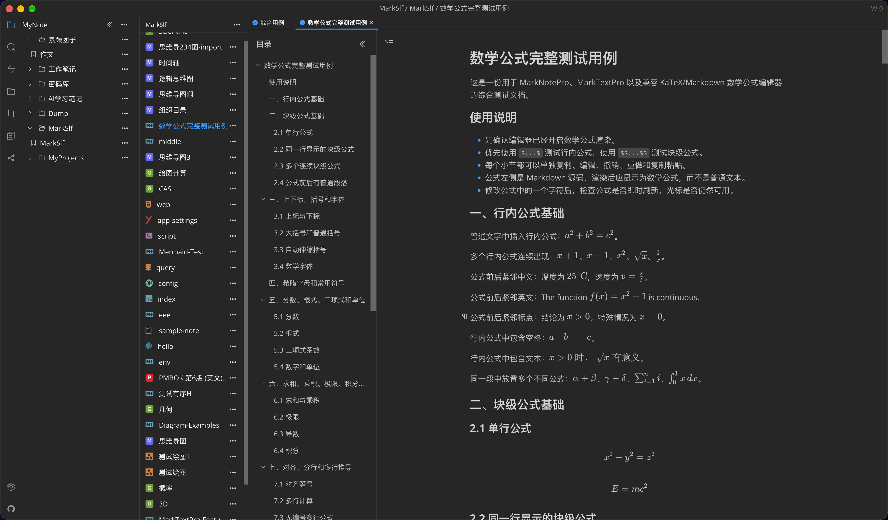
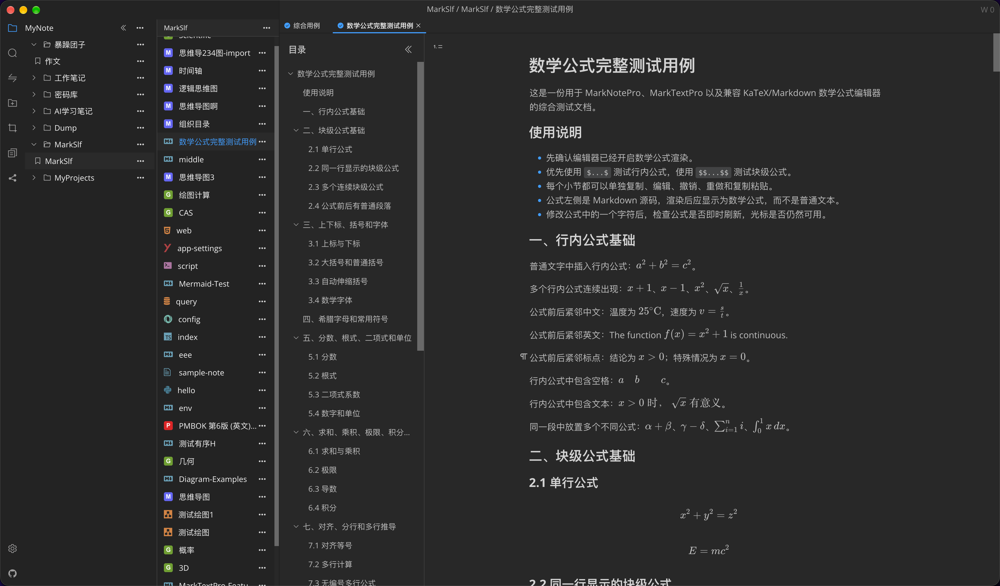
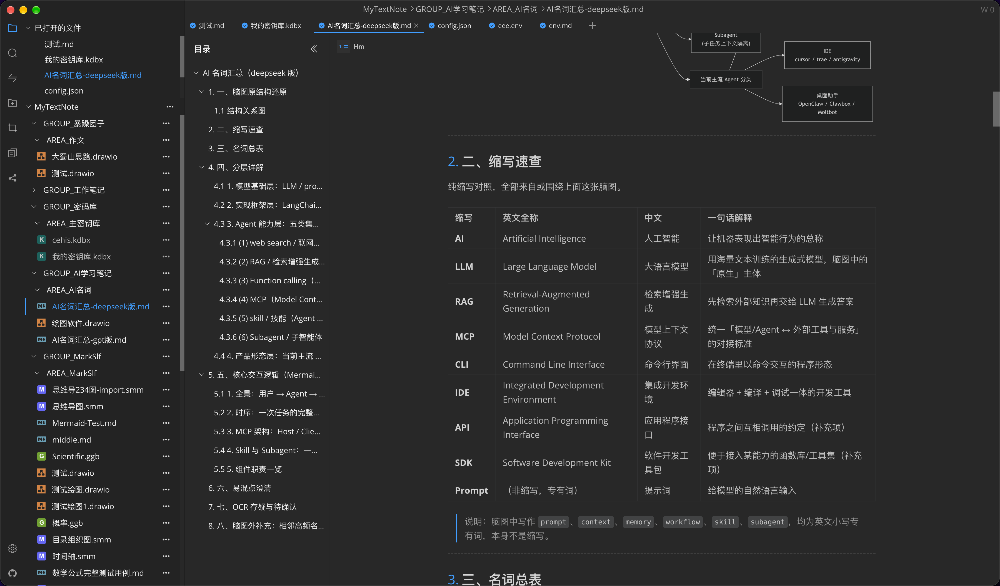
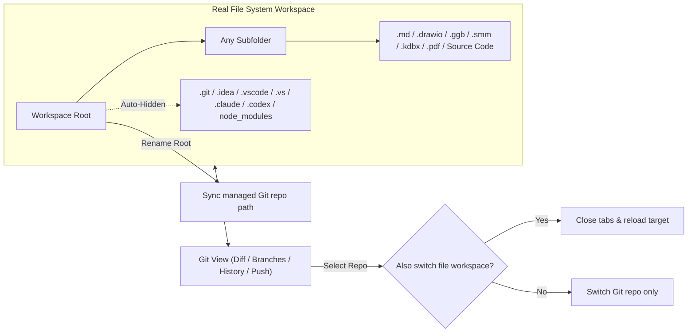

<p align="center"></p>

<h1 align="center">MarkTextPro</h1>

<div align="center">
  <strong>Local Open-Filesystem Documents & All-in-One Multimodal Workbench</strong><br>
  Directly open, edit, and annotate authentic folders, code repositories, and standalone external files on disk, backed by a built-in productivity workbench: Markdown, Draw.io, GeoGebra, MindMap, PDF annotation, KDBX keystore (2FA & SSH/SFTP), LAN Share / MarkShare transfer, and Git version control.<br>
  <sub>Linux · macOS · Windows (Core creation & encryption engines work 100% offline)</sub>
</div>

<div align="center">
  <a href="README.md">简体中文</a>
  <span> | </span>
  <strong>English</strong>
</div>

<br>

<div align="center">
  <a href="LICENSE">
    
  </a>
  <a href="https://github.com/scott20201225/marktext-pro/releases">
    
  </a>
  <a href="https://github.com/scott20201225/marktext-pro/releases/latest">
    
  </a>
  <a href="https://gitee.com/cmflovekm/marktext-pro">
    
  </a>
</div>

<div align="center">
  <h4>
    <a href="#feature-showcase">Showcase</a>
    <span> · </span>
    <a href="#positioning--product-comparison">Comparison</a>
    <span> · </span>
    <a href="#core-capabilities">Capabilities</a>
    <span> · </span>
    <a href="#file-workspace--git-integration">Workspace & Git</a>
    <span> · </span>
    <a href="#security-guidelines">Security</a>
    <span> · </span>
    <a href="#download--build">Download & Build</a>
    <span> · </span>
    <a href="#license--third-party-notices">License</a>
  </h4>
</div>

---

## Feature Showcase

A complete overview covering local open-filesystem docs, Markdown & enhanced tables, Draw.io diagrams, MindMaps, Git workflows, GeoGebra modeling, KDBX keystores (2FA/SSH), multi-workspace switching & migration, screenshot pinning, clipboard history, LAN Share / MarkShare P2P transfer, and in-place PDF annotation:

<p align="center">
  
</p>

## Positioning & Product Comparison

**MarkTextPro** is a **local open-filesystem document editor**: it preserves authentic directory trees without forcing notebook hierarchies, ideal for codebases, project docs, and opening standalone external files directly from disk—with multimodal creation, security workbench tools, and LAN sharing built in underneath.

Its sibling **[MarkNotePro](https://github.com/scott20201225/marknote-pro)** is a **local structured note-taking app** tailored for long-term hierarchical knowledge bases. Visual comparison of the same directory opened in both products:

<table>
  <tr>
    <td align="center" width="50%">
      
      <br>
      <sub><b>MarkNotePro</b>: Displays only structured note hierarchies and supported knowledge assets</sub>
    </td>
    <td align="center" width="50%">
      
      <br>
      <sub><b>MarkTextPro</b>: Mirrors real file system trees for codebases & standalone external docs</sub>
    </td>
  </tr>
</table>

| Dimension | MarkTextPro (This Repo) | [MarkNotePro](https://github.com/scott20201225/marknote-pro) (Sibling Project) |
| --- | --- | --- |
| **Core Positioning** | **Local Open-Filesystem Docs** (raw folders & external files) | **Local Structured Notes** (knowledge hierarchy & PKM) |
| **Organization** | Open file system directory trees plus standalone external file editing | Structured Workspace / Section Groups / Sections / Docs (Tree & List modes) |
| **Best For** | Code repositories, project READMEs, free folders & ad-hoc file editing | Personal PKM, structured technical notes, research assets & local vaults |
| **Built-in Workbench** | Identical offline engines, KDBX/2FA/SSH workbench, Git integration & LAN transfer | Same |
| **Links** | [GitHub Releases](https://github.com/scott20201225/marktext-pro/releases/latest) · [Gitee Mirror](https://gitee.com/cmflovekm/marktext-pro) | [GitHub Releases](https://github.com/scott20201225/marknote-pro/releases/latest) · [Gitee Mirror](https://gitee.com/cmflovekm/marknote-pro) |

## Core Capabilities

### 1. Built-in Offline Multimodal Engines

Read and write open formats directly inside real folders or external disk paths without proprietary lock-in:

| Engine / Format | Key Features | Assets & Import/Export |
| --- | --- | --- |
| **Markdown** (`.md`) | WYSIWYG editing with LaTeX math, Mermaid diagrams & charts, 5 Callout styles, quick insert palette, bulk task editing & enhanced table toolkit | Local images auto-saved to relative `Attachments/`; two-way Excel table interop |
| **Draw.io** (`.drawio`) | Offline diagrams.net editor for architecture, flowcharts, UML, ER & network topologies with multi-tab state & auto-save | Export to `PNG`, `JPEG`, `SVG`, `PDF`, `HTML`, `XML` |
| **GeoGebra** (`.ggb`) | Official 6-in-1 suite: Graphing, Geometry, 3D Calculator, CAS, Probability & Scientific Calculator | Embedded media inside `.ggb`; export `.ggb`, `.png`, `.svg`, `.pdf`, `.stl` (3D print) & print |
| **MindMap** (`.smm`) | 6 layouts (Mind Map, Logic, Organization, Catalog, Timeline, Fishbone); LaTeX, stickers, links, summaries, frames, synced outline & shortcut panel | Import `.xmind` / `.md` / `.smm` / `.json` / `.mind` (created & opened in current folder); export `PNG`, `SVG`, `PDF`, `Markdown`, `JSON` & print |
| **PDF Reader & Annotator** (`.pdf`) | Mozilla PDF.js engine: outline, thumbnails, full-text search, rotation & adaptive dark/light themes; highlights, underline/strikethrough, freehand ink, text notes, stamps & signatures | Silent in-place overwrite via `Cmd+S / Ctrl+S` with dirty-state sync |
| **Plain Text & Config** | Fast viewing, lightweight editing & in-place saving for `.txt`, `.json`, and project config files | Direct local disk read/write |

### 2. KDBX Encrypted Keystore, 2FA & SSH/SFTP Workbench

Powered by [KDBXWeb](https://github.com/keeweb/kdbxweb) and an integrated terminal stack:

- **KDBX Credential Vault**: Master-password-protected `.kdbx` databases supporting groups, entries, custom fields, tags, attachments, revision history, recycle bin, password reset & passcode-encrypted import/export.
- **TOTP 2FA Codes**: Live countdown timer supporting QR scanning, **clipboard screenshot pasting (`Cmd+V / Ctrl+V`)**, and batch `otpauth://` / Base32 URI import with deduplication & anti-replay terminal integration.
- **SSH Direct Connect & File Transfer**: **Requires an established `.kdbx` keystore**—sessions must be launched via stored entries, enabling **automated 2FA login**, a graphical **SFTP drawer** (browse, upload/download, edit, delete confirmation), and native **ZMODEM (`rz / sz`)** transfer.

### 3. LAN Sharing & Desktop Productivity Suite

- **LAN Share Portal**: One-click LAN publishing with QR codes, passcode lock, **"My Shares / Shared With Me"** views, and configurable folder layout & conflict resolution.
- **MarkShare P2P Direct Transfer**: Automatic LAN peer discovery with **drag-and-drop radar overlay** and multi-device context-menu push (X25519 + AES-256-GCM + SAS verification), interoperable between `MarkTextPro` and `MarkNotePro`.
- **Multi-Workspace Switch & Migration**: Switch workspaces smoothly with built-in **auto-merge prompts** and **manual conflict resolution**.
- **Screenshot, Screen Pinning & Clipboard History**: Global hotkey capture, always-on-top screen pins, and searchable local clipboard history.
- **Standalone & Multi-Tab Editing**: Open external `.md / .drawio / .ggb / .smm / .kdbx / .pdf / .txt / .json` files directly and keep multiple heterogeneous editors alive across tabs.

## File Workspace & Git Integration

MarkTextPro pairs an integrated Git workspace (inspired by GitHub Desktop) directly with real directory trees for cloning, diff review, branching, commit history, and push/pull synchronization.



- **Noise Reduction & Tab Sync**: Hides `.git`, `node_modules`, and IDE/agent config directories by default; cutting, pasting, renaming, or deleting files/folders safely updates or closes affected editor tabs.

## Security Guidelines

1. **Use Private Repositories**: Always host project documentation, configs, and personal assets in **private** Git repositories (`GitHub`, `Gitee`, `GitLab`, etc.).
2. **Never Push `.kdbx` to Public Repos**: Despite AES-256 / ChaCha20 encryption, exposing `.kdbx` publicly allows unlimited offline brute-force attacks. Exclude `*.kdbx` via `.gitignore` in open-source repos.
3. **Set a 16-Character Strong Master Password**: Use all 16 allowed alphanumeric mixed-case characters and avoid weak or reused passwords.

## Download & Build


- **GitHub Official Releases**: [https://github.com/scott20201225/marktext-pro/releases/latest](https://github.com/scott20201225/marktext-pro/releases/latest)
- **Gitee Mirror**: [https://gitee.com/cmflovekm/marktext-pro](https://gitee.com/cmflovekm/marktext-pro)
- **Installers**: macOS `marktextpro-mac-(arm64|x64)-%version%.dmg` · Windows `marktextpro-win-(x64|arm64)-%version%-setup.exe` · Linux `deb / rpm / snap / tar.gz`

```bash
# Development
pnpm install
pnpm --filter marktextpro dev

# Production build
pnpm --filter marktextpro build
```

## License & Third-Party Notices

Licensed under the **[MarkTextPro Non-Commercial Use and Commercial Authorization License](LICENSE)**:

- **Free for Non-Commercial Use**: Personal study, education, academic research, and personal tech/document management.
- **Commercial Authorization Required**: Any commercial sale, SaaS bundling, enterprise commercial deployment, or redistribution without attribution requires prior written authorization from [ScottCheng](https://github.com/scott20201225).

<details>
<summary>Third-Party Open-Source Component Licenses (8 Components)</summary>

- **draw.io (diagrams.net)**: [Apache License 2.0](https://www.apache.org/licenses/LICENSE-2.0) (`Copyright (c) 2005-present JGraph Ltd`)
- **GeoGebra**: [GeoGebra License](https://www.geogebra.org/license) (Source under **GPLv3**; binaries, docs, and language assets under **GeoGebra Non-Commercial License Agreement / CC BY-NC-SA 3.0**, free for non-commercial use only)
- **simple-mind-map**: [MIT License](https://github.com/wanglin2/mind-map/blob/main/LICENSE) (`Copyright (c) 2021-2023 The MindMap Team / wanglin2`)
- **KDBXWeb**: [MIT License](https://github.com/keeweb/kdbxweb/blob/master/LICENSE) (`Copyright (C) 2021-2025 Antelle`)
- **PDF.js**: [Apache License 2.0](https://www.apache.org/licenses/LICENSE-2.0) (`Copyright 2024 Mozilla Foundation`)
- **Tabby**: [MIT License](https://github.com/Eugeny/tabby/blob/master/LICENSE) (`Copyright (c) 2017-present Eugenia Kim (Eugeny)`)
- **GitHub Desktop**: MIT License (`Copyright (c) GitHub, Inc.`)
- **MarkText & Muya**: MIT License (`Copyright (c) 2017-present Luo Ran & MarkText Contributors`)

</details>
